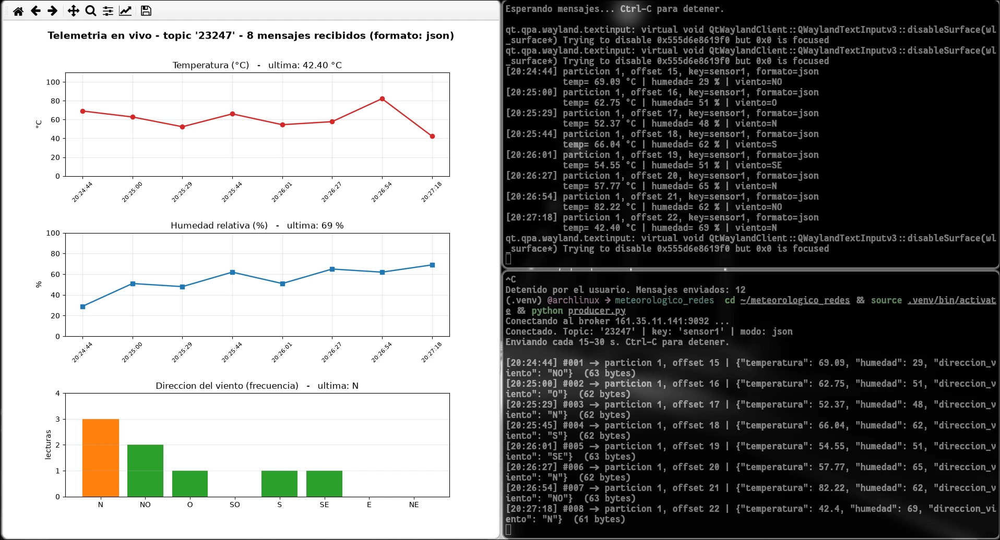

# Estación Meteorológica IoT con Apache Kafka

Laboratorio de **CC3067 Redes** — Universidad del Valle de Guatemala.

Simulamos un nodo de sensores de una estación meteorológica que manda su
telemetría a un broker de Kafka en el borde (Edge), y del otro lado un
consumidor que la recibe y la grafica en tiempo real.

**Integrantes**

| Carné | Nombre |
|---|---|
| 23247 | Ricardo Godínez |
| 23201 | Vianka Castro |

## Evidencia

Productor y consumidor corriendo en vivo contra el broker, topic `23247`:



A la izquierda las gráficas que se redibujan con cada mensaje; arriba a la
derecha el consumidor recibiendo, abajo el productor enviando. Se puede ver que
los offsets coinciden en ambas terminales (15 al 22) y que el intervalo entre
envíos cae entre 15 y 30 segundos.

## Cómo funciona

```
producer.py  ──publica──►  Kafka 161.35.11.141:9092  ──entrega──►  consumer.py
  simula el                    topic '23247'                        grafica
  clima                        key 'sensor1'                        en vivo
```

**Productor** (`producer.py`) — hace de "la cosa", el nodo de sensores:

- Temperatura: normal de media 55 y sigma 15, recortada a `[0, 110.00]`, float de dos decimales.
- Humedad relativa: misma distribución, recortada a `[0, 100]`, entero.
- Dirección del viento: uniforme sobre `{N, NO, O, SO, S, SE, E, NE}`.
- Arma el mensaje en JSON y lo publica cada 15–30 segundos, hasta que lo paren con Ctrl-C.

**Consumidor** (`consumer.py`) — hace de backend detrás del Edge:

- Se suscribe al topic y hace `poll()` cada 500 ms, así la ventana sigue viva aunque no entren datos.
- Detecta solo si el payload viene en JSON o en los 3 bytes de la sección 3.4.
- Acumula el histórico y redibuja las tres gráficas con cada mensaje nuevo.

## Archivos

| Archivo | Qué hace |
|---|---|
| `producer.py` | Nodo IoT: genera la telemetría y la publica |
| `consumer.py` | Consumidor: recibe y grafica en tiempo real |
| `codec.py` | `encode`/`decode` del payload de 3 bytes |
| `config.py` | Broker, topics y carga de credenciales |
| `credenciales.env.example` | Plantilla de credenciales (ver abajo) |

## Correrlo

```bash
python -m venv .venv && source .venv/bin/activate
pip install -r requirements.txt
cp credenciales.env.example credenciales.env   # y llenarlo con los datos del enunciado
```

Las credenciales SASL no están en el repo: van en `credenciales.env`, que está
en el `.gitignore`.

Terminal 1, el consumidor (abrirlo primero para no perder mensajes):

```bash
python consumer.py --save grafica.png
```

Terminal 2, el productor:

```bash
python producer.py                   # JSON, cada 15-30 s
python producer.py --mode raw        # payload de 3 bytes
python producer.py --min 3 --max 5   # intervalo corto, para probar
```

El topic por defecto es `23247`. Con `--topic` se puede apuntar a otro, por
ejemplo `23201`.

## Payload de 3 bytes (sección 3.4)

Para el escenario tipo LoRa/Sigfox, donde el mensaje no puede pasar de 24 bits:

```
[ temperatura : 14 bits ][ humedad : 7 bits ][ viento : 3 bits ]  =  24 bits
```

El truco está en la temperatura: en vez del float se manda `round(temp * 100)`,
o sea un entero entre 0 y 11000. Como `2^14 = 16384 ≥ 11001`, el rango completo
`[0, 110.00]` cabe en 14 bits sin perder los dos decimales. La humedad es un
entero de 0 a 100 (7 bits) y el viento un índice de 8 opciones (3 bits).
